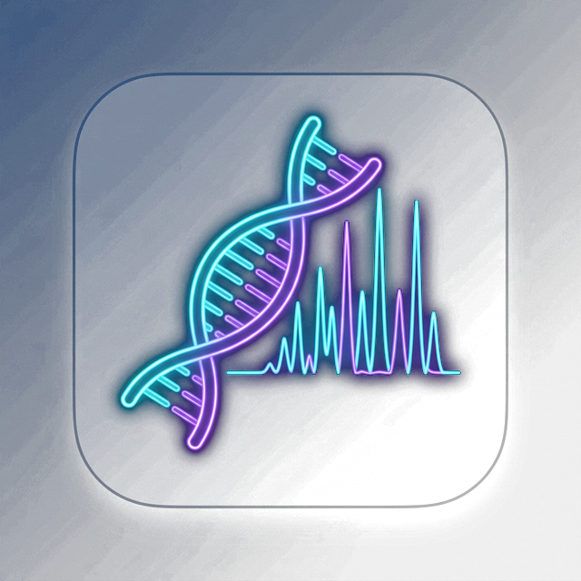

<p align="center">
  
</p>

<h1 align="center">HemaFrag Diagnostics</h1>

<p align="center">Offline fragment analysis, ladder review, quality control, and reporting for Windows 10 and 11.</p>

<p align="center">
  <a href="https://github.com/Christian-Bjornstad/HemaFrag-Diagnostics/actions/workflows/ci.yml"></a>
  
  
  
</p>

HemaFrag combines a PyQt6 desktop interface with a Rust analysis engine. Runs,
manual ladder corrections, reports, and tracking workbooks stay on the local
computer or the operator's configured storage.

| Workflow | Capabilities |
|---|---|
| Clonality | Assay-specific peak analysis, patient/control grouping, ladder review, QC, and tracking |
| FLT3 | GS500ROX/DATA4 by default, WT/mutant area ratios, ITD/TKD grouping, NPM1 manual review, and tracking |
| General | Configurable ladder, size-standard channel, sample channels, and analysis range |
| Reporting | Interactive HTML reports, saved manual peaks, batch manifests, and Excel workbooks |

Analysis results and algorithm changes require laboratory review and local
validation before operational use. This repository contains no clinical input
corpus. Automated tests use synthetic data and engineering regression cases.

## Requirements

- Windows 10 or Windows 11, **64-bit x86**.
- For source installation: 64-bit Python **3.12, 3.13, or 3.14**; Python 3.14
  is the work-computer route. CI tests Python 3.12 and 3.14.
- Internet access for initial dependency installation, or an approved offline
  wheel cache. Analysis and generated reports work offline.
- Rust/MSVC build tools are needed only to rebuild the native engine or package
  the desktop application. The checked-in ABI3 wheel needs no Rust installation.

## Quick start

Run these commands in PowerShell:

```powershell
git clone https://github.com/Christian-Bjornstad/HemaFrag-Diagnostics.git
Set-Location HemaFrag-Diagnostics
py -3.14 -m venv .venv
.\.venv\Scripts\python.exe -m pip install --upgrade pip
.\.venv\Scripts\python.exe -m pip install -r requirements.txt
.\.venv\Scripts\python.exe -m pip install --no-deps .\wheels\fraggler_kernels-0.1.3-cp310-abi3-win_amd64.whl
.\.venv\Scripts\python.exe .\qt_app.py
```

If an approved Python environment is already available, use its interpreter and
skip creating a virtual environment. Verify the engine in that environment:

```powershell
python -c "import fraggler_native; print(fraggler_native.version, fraggler_native.is_available())"
```

Expected output: `0.1.3 True`. The `cp310-abi3` filename denotes the stable Python
ABI; the wheel also runs on the supported newer Python versions.

To create a shortcut for a source installation, using that same interpreter:

```powershell
powershell -ExecutionPolicy Bypass -File packaging\create_windows_shortcut.ps1 `
  -PythonPath "C:\path\to\approved-python\python.exe"
```

For a packaged desktop application, extract the entire `HemaFrag_Windows.zip`
folder and start `HemaFrag.exe`. Keep its `_internal` directory beside it.
See the [Windows packaging guide](packaging/README.md).

## Using HemaFrag

1. Choose Clonality, FLT3, or General and configure input/output paths in Settings.
2. Discover the inputs on **Run**, inspect the selected jobs, and start analysis.
3. Review rejected or ambiguous ladder fits on **Ladder**. Save valid corrections
   or mark unusable input, then rerun affected files.
4. Finalize the batch when its review queue is resolved. Inspect the final report,
   manifest state, and tracking output before using the results.
5. Use **Archive Runner** to resume manifest-backed historical runs and **Log**
   to inspect failures.

See the [workflow guide](docs/usage.md) and the Norwegian
[user manual](docs/HemaFrag_Brukerveiledning.docx).

## Development and verification

```powershell
python -m pip install -r requirements-dev.txt
python -m pytest -q
python -m ruff check --select F821 core gui_qt hemafrag_diagnostics qt_app.py config.py app_meta.py app_resources.py build_qt.py
cargo test --locked --manifest-path fraggler-v2/Cargo.toml --workspace --exclude fraggler-kernels-py
cargo check --locked --manifest-path fraggler-v2/Cargo.toml -p fraggler-kernels-py
```

Node.js is needed for JavaScript report interaction tests. Optional corpus or
platform-specific tests explain their skip conditions. Synthetic tests do not
establish clinical accuracy on the private laboratory corpus.

See [CONTRIBUTING.md](CONTRIBUTING.md) for development and validation expectations,
[architecture](docs/architecture.md) for module responsibilities, and
[CHANGELOG.md](CHANGELOG.md) for release changes.

## Repository layout

```text
core/                    Analysis pipelines, provenance, reporting, and tracking
fraggler/                Embedded Python scientific compatibility layer
fraggler-v2/             Rust core, recovery CLI, and PyO3 extension
gui_qt/                  PyQt6 desktop interface
hemafrag_diagnostics/     Installed Python entry point
assets/                  Application icons and offline Plotly bundles
packaging/               Windows build tools and runtime hooks
scripts/                 Validation, archive processing, and maintenance tools
tests/                   Regression and workflow tests
wheels/                  Versioned Windows native-engine wheel
docs/                    Current architecture and user documentation
```

Raw FSA data, patient identifiers, generated reports, local adjustment databases,
validation outputs, build products, and personal development notes stay outside
Git. Historical plans and session logs remain recoverable in Git history.

## Licenses and notices

The application has no single root open-source license. Embedded Fraggler-derived
code retains its [MIT license](LICENSES/fraggler_MIT.txt). See
[third-party notices](THIRD_PARTY_NOTICES.md) for the component notices distributed
with HemaFrag.
